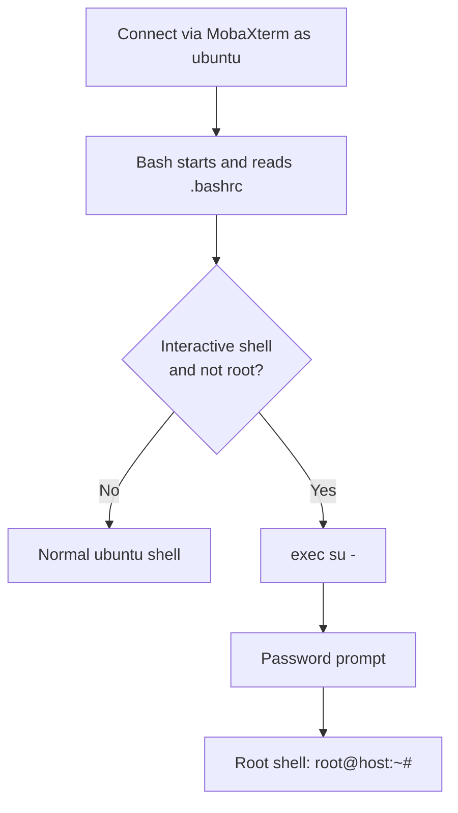

<h1 align="center">Auto-Root Login</h1>

<p align="center">
  Automatically switch to the <code>root</code> user, with a password prompt,<br>
  every time you SSH into an Ubuntu server.
</p>

<p align="center">
  
  
  
  
</p>

---

## Table of Contents

- [Overview](#overview)
- [Project Structure](#project-structure)
- [How It Works](#how-it-works)
- [Requirements](#requirements)
- [Method A: Automated Setup](#method-a-automated-setup)
- [Method B: Manual Setup](#method-b-manual-setup)
- [Testing](#testing)
- [Undo](#undo)
- [Troubleshooting](#troubleshooting)
- [Alternative Methods](#alternative-methods)
- [Security Notes](#security-notes)
- [FAQ](#faq)
- [Documentation](#documentation)

---

## Overview

By default, getting root on an Ubuntu server means typing `sudo su` after every login. This project removes that step. When you connect as `ubuntu`, the server runs `su -` automatically, asks for **root's password**, and opens a root login shell.

| | |
|---|---|
| **Environment** | Ubuntu on AWS EC2 |
| **SSH client** | MobaXterm |
| **Method** | One line added to the user's `.bashrc` |
| **Setup options** | Automated script or manual commands |

> [!WARNING]
> Running as root permanently is risky. One wrong command, such as a misplaced `rm -rf`, can damage the whole system. This project is intended for **labs and learning**, not production servers.

---

## Project Structure

```
auto-root-login/
├── README.md                          Project overview and instructions
├── setup.sh                           Automated installer
├── docs/
│   └── Auto-Root-Login-Guide.pdf      Full PDF guide
└── images/
    └── terminal-output.png            Screenshot of the setup running
```

---

## How It Works

When you log in, Bash reads `~/.bashrc`. We add one line at the end of that file:

```bash
[[ $- == *i* && $EUID -ne 0 ]] && exec su -
```

| Part | What it does |
|------|--------------|
| `$- == *i*` | True only in **interactive** terminals. Keeps MobaXterm's SFTP sidebar and other non-interactive sessions from hanging. |
| `$EUID -ne 0` | True only if you are **not already root**. Prevents the line from looping once you are root. |
| `&&` | Runs the next command only if both checks passed. |
| `exec su -` | Replaces the current shell with a root **login** shell. `su -` asks for root's password, and `exit` ends the session cleanly. |

### Login flow



### Why `su -` and not `sudo su`?

On AWS EC2, the `ubuntu` user has **passwordless sudo** by default, so `sudo su` never asks for a password. `su -` asks for **root's own password**, which is what provides the password prompt. That is why this setup first gives root a password.

---

## Requirements

| Requirement | Details |
|-------------|---------|
| Server | Ubuntu (tested on AWS EC2) |
| User | A normal user with `sudo` access (the default `ubuntu` user on EC2) |
| SSH client | MobaXterm, or any SSH client |
| Second tab | A second open terminal tab to test safely |

---

## Method A: Automated Setup

The script performs the same steps as the manual method, with backups, checks and a step-by-step display. Copy `setup.sh` to your server and run it as your normal user:

```bash
bash setup.sh
```

| Command | What it does |
|---------|--------------|
| `bash setup.sh` | Installs the auto-root login |
| `bash setup.sh status` | Shows whether it is currently active |
| `bash setup.sh uninstall` | Removes the line it added |
| `bash setup.sh --dry-run` | Shows what would happen without changing anything |

### What the installer does

| Step | Action |
|------|--------|
| 1/5 Pre-flight checks | Confirms `su`, `passwd` and `sudo` access are available |
| 2/5 Set the root password | Asks whether to set or change root's password, then runs `sudo passwd root` |
| 3/5 Back up `.bashrc` | Saves a timestamped copy, for example `.bashrc.bak.1791367523` |
| 4/5 Add the line | Appends the auto-switch line (marked with a comment) |
| 5/5 Verify | Confirms the line is present and prints it |

The script is safe to re-run. If the line is already installed, it is detected and not added twice.

---

## Method B: Manual Setup

Log in as `ubuntu` through MobaXterm. Your prompt looks like this:

```
ubuntu@ip-172-31-38-241:~$
```

### Step 1: Set a password for root

On EC2, root has no password by default.

```bash
sudo passwd root
```

Enter the password twice. Nothing is shown while you type. Expected output:

```
passwd: password updated successfully
```

### Step 2: Add the auto-switch line

```bash
echo '[[ $- == *i* && $EUID -ne 0 ]] && exec su -' >> /home/ubuntu/.bashrc
```

> [!TIP]
> Use the **full path**. If you are already root when you run this, `~` points to `/root` and the line would be added to the wrong file.

### Step 3: Verify

```bash
tail -n 2 /home/ubuntu/.bashrc
```

The last line should be:

```
[[ $- == *i* && $EUID -ne 0 ]] && exec su -
```

### Terminal output


*Setting the root password, adding the auto-switch line, and verifying it.*

---

## Testing

> [!IMPORTANT]
> Keep your current tab open and test in a **new tab**. If something is misconfigured, the open tab is your way back in to fix it.

| # | What to do | Expected result |
|---|------------|-----------------|
| 1 | Open a new SSH session as `ubuntu` | Connects normally |
| 2 | Watch the terminal | A `Password:` prompt appears automatically |
| 3 | Enter the root password | Prompt changes to `root@ip-172-31-38-241:~#` |
| 4 | Run `whoami` | Prints `root` |
| 5 | Check the MobaXterm file sidebar | Still loads normally |

---

## Undo

Using the script:

```bash
bash setup.sh uninstall
```

Or manually, which removes the last line of the file:

```bash
sed -i '$d' /home/ubuntu/.bashrc
```

Only use the manual command if the auto-switch line is still the **last line** of the file. Otherwise open `nano /home/ubuntu/.bashrc` and delete it by hand.

---

## Troubleshooting

| Problem | Cause | Fix |
|---------|-------|-----|
| Kicked out right after entering the password | Wrong root password. `exec` closes the session on failure. | Use your open tab and reset it with `sudo passwd root` |
| Locked out of every new session | The line is active but the root password is unknown or not set | Fix from an already-open session, or see the recovery tip below |
| MobaXterm file sidebar hangs | The interactive check is missing from the line | Make sure the line contains `$- == *i*` |
| No password prompt appears | Line was not saved, or the wrong `.bashrc` was edited | Run `tail -n 2 /home/ubuntu/.bashrc`, then reconnect with a fresh login |
| Line ended up in root's file | Command run as root using `~` instead of the full path | Use `/home/ubuntu/.bashrc` explicitly |

### Recovery tip

If you are locked out and have no open session, connect with a standard SSH client and ask for a shell that skips startup files. The auto-switch line only runs in interactive login shells, so this should get you in:

```bash
ssh -i your-key.pem -t ubuntu@YOUR_SERVER_IP "bash --norc"
```

Then remove the line with `bash setup.sh uninstall` or the manual command from [Undo](#undo).

---

## Alternative Methods

| Method | Pros | Cons |
|--------|------|------|
| **MobaXterm Execute command**<br>Edit session, Advanced SSH settings, Execute command: `su -` | No server changes. Easiest to undo. | Only applies to that saved MobaXterm session |
| **Direct root SSH login**<br>`PermitRootLogin yes` in `/etc/ssh/sshd_config` | Root is truly the default user | Riskiest option. Root over SSH is a common attack target. On EC2 you must also check `/etc/ssh/sshd_config.d/*.conf`. |
| **`.bash_profile` instead of `.bashrc`** | Runs only on login shells | Can change which startup files load. Test carefully. |

---

## Security Notes

- Use a **strong, unique root password**. Root accounts on public servers are heavily targeted.
- This setup does **not** change SSH authentication. You still connect with your key pair, and the password prompt comes from `su -` after you log in.
- For real systems, log in as a normal user and use `sudo` only when you need elevated rights.
- Never commit passwords, `.pem` key files, or private server details to a public repository.

---

## FAQ

**Does this change who can log in over SSH?**
No. SSH access is unchanged. This only affects what happens after a successful login.

**Does it affect other users?**
No. It edits one user's `.bashrc` only.

**Can I use a different username?**
Yes. Replace `ubuntu` with your username in the commands. The script uses the user who runs it.

**Will `scp` and SFTP still work?**
Yes. The interactive check means non-interactive sessions are skipped.

---

## Documentation

A full PDF version of this guide is available in [`docs/Auto-Root-Login-Guide.pdf`](docs/Auto-Root-Login-Guide.pdf).
